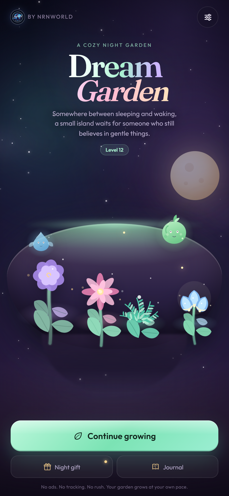

# Dream Garden

**A cozy night-garden simulation. By nRnWorld.**

Grow impossible flowers, befriend six shy dream spirits, decorate a floating island and uncover a
gentle six-chapter mystery — a few minutes at a time, at your own pace.

Dream Garden is a complete, offline-first mobile web game built with React, TypeScript and Vite,
installable as a PWA and ready to be wrapped with Capacitor for Google Play and the App Store.



## The promise

- **No ads, no tracking, no timers that punish you.** The whole campaign is playable for free.
- **A meaningful action within 30 seconds.** Tap a bed, choose a seed, watch it grow.
- **Gentle progression.** Twelve beds, eight flowers, six spirits, six story chapters, twelve
  achievements, daily gifts and decor — tuned to be finished in roughly two to three weeks of
  relaxed play, not gated behind paywalls.
- **Your garden keeps growing while you are away,** but never wilts and never punishes absence.
- **Seven languages**, including full right-to-left Arabic.

## Features

| Area | What is in the build |
| --- | --- |
| Garden | 12 beds (6 open, 6 unlockable), growth stages, watering, dream boosts, harvest, harmony multiplier |
| Flowers | 8 hand-drawn procedural species with distinct silhouettes and palettes |
| Spirits | 6 spirits, bond levels, offerings, equippable passives (dew, growth, harmony, stardust) |
| Economy | Dew, stardust, XP/levels, 3 rotating wish orders per refresh, sell-all basket |
| Story | 6 written chapters, unlock conditions, journal with story, achievements and lifetime stats |
| Live ops | Daily night gift with streak, three free Moonwell boosts per local day |
| Cosmetics | 6 decorations placed around the island, purchased with dew |
| Comfort | Tutorial, contextual next-step goal, reduced motion, large text, sound and haptics toggles |
| Persistence | Versioned save, repair-on-load, rolling backup, import/export, reset |
| Platform | Installable PWA, offline cache, safe-area layout, portrait and tablet layouts |

## Tech stack

- React 19 + TypeScript 5.9
- Vite 7, `vite-plugin-pwa` (Workbox service worker)
- Zustand 5 for the game store
- Vitest for domain and localization tests
- Pure SVG/CSS art and animation — no raster game assets, no art pipeline required
- Zero runtime network calls; no analytics, ads or third-party scripts

## Quick start

```bash
bun install
bun run dev        # http://127.0.0.1:5173
bun run test       # 50 domain + i18n tests
bun run typecheck
bun run build      # production PWA in dist/
bun run preview
```

Node 20+ or Bun 1.2+ is required. The build is fully static and can be hosted on any HTTPS static
host.

## Project structure

```
src/
  game/          pure domain: content data, economy engine, save system, store, audio
  components/    garden scene, procedural plant/spirit/deco art, HUD, sheets, tutorial
  screens/       onboarding, title, garden, seeds, wishes, spirits, journal
  i18n/          English source dictionary + six complete translations
  styles/        design tokens, layout, garden, screens, sheets, onboarding
  test/          engine, save and localization suites
public/
  flags/         public-domain country flags (never redrawn)
  fonts/         Fraunces + Outfit (SIL OFL)
  icons/         PWA, maskable and store icons
store/           listing copy, screenshots and generated store art
docs/            art bible, architecture decisions, QA, localization, packaging
```

## Documentation

- [PLAN.md](PLAN.md) — product scope and milestones
- [ARCHITECTURE.md](ARCHITECTURE.md) — layers, data flow, save format, decisions
- [TASKS.md](TASKS.md) — delivery checklist
- [ACCEPTANCE_CRITERIA.md](ACCEPTANCE_CRITERIA.md) — definition of done
- [RISK_REGISTER.md](RISK_REGISTER.md) — known risks and mitigations
- [HUMAN_ACTIONS.md](HUMAN_ACTIONS.md) — everything only the owner can do (accounts, signing, legal)
- [RELEASE_REPORT.md](RELEASE_REPORT.md) — what was verified, with limitations
- [BUILDING.md](BUILDING.md) — local build, PWA and Capacitor packaging
- [RELEASE_CHECKLIST.md](RELEASE_CHECKLIST.md) — store submission checklist
- [PRIVACY.md](PRIVACY.md) — the actual privacy posture of this build
- [docs/ART_BIBLE.md](docs/ART_BIBLE.md) — visual language
- [docs/LOCALIZATION.md](docs/LOCALIZATION.md) — locale rules and verification
- [docs/ACCESSIBILITY.md](docs/ACCESSIBILITY.md) — accessibility commitments
- [docs/MONETIZATION.md](docs/MONETIZATION.md) — honest, optional revenue design
- [docs/STORE_LISTING.md](docs/STORE_LISTING.md) — store copy and asset plan
- [docs/QA_MATRIX.md](docs/QA_MATRIX.md) — manual test matrix
- [docs/ANDROID_PACKAGING.md](docs/ANDROID_PACKAGING.md) — Play Store wrapping steps

## License

Source is source-available for non-commercial educational use under the custom
[nRnWorld Educational License](LICENSE). Commercial distribution, sale or ad-supported reuse
requires written permission from bynrnworld@gmail.com. Third-party assets are listed in
[THIRD_PARTY_NOTICES.md](THIRD_PARTY_NOTICES.md).

Game, art, writing and code © 2026 nRnWorld. All rights reserved.
